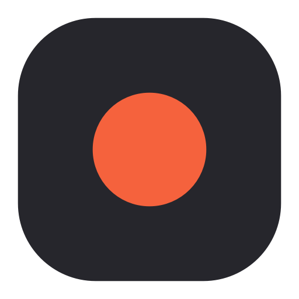

<div align="center">



# Clipr

**English** · [Русский](README.ru.md)

Record a part of your screen and turn it into a small, sharp GIF —
ready to paste into a chat with `Ctrl + V`.

</div>

## Download

1. Open the [Releases](https://github.com/SmeshidoJoe/Clipr/releases/latest) page.
2. Download `Clipr-Setup-….exe` and run it. No administrator rights needed.
3. On first launch Clipr offers to download FFmpeg (about 80 MB) — it does the
   actual recording. Say yes.

If Windows shows a blue “Windows protected your PC” window, click
**More info → Run anyway**. This happens with every app that doesn't have a
paid code-signing certificate.

Works on Windows 10 and 11.

## How to use

Clipr lives in the tray, next to the clock. A small panel sits at the bottom of
the screen:

1. **Pick an area** — the corners button. Drag a frame, or just click to take the
   whole monitor. The × next to the area size on the panel goes back to full screen.
2. **Record** — the red button. Pause and stop are on the same panel.
3. **Edit** — after you stop, an editor opens. Drag the handles on the timeline
   to trim, drag over the video to crop.
4. **Export GIF** (or `Enter`). The GIF is saved and **copied to the clipboard as
   a file**, so `Ctrl + V` in Telegram, Discord, Slack or Explorer pastes the GIF
   itself. A small notification confirms it; click it to see the file.

The panel never shows up in your recordings, even though it stays on screen.

| Shortcut | Works in any app |
| --- | --- |
| `Ctrl + Alt + R` | start / stop recording |
| `Ctrl + Alt + P` | pause / resume |
| `Ctrl + Alt + A` | pick an area (while the panel is open) |
| `Ctrl + Alt + X` | show / hide the panel |

In the editor: `Space` play/pause, `←` `→` one frame, `R` reset crop, `Esc` close.

**Making the GIF smaller.** In the editor, lower **Size** (a share of the
recorded area: 50 % of 752×648 is 376×324) or **FPS**. **Compression** shrinks
the file further but adds a bit of noise to flat colors, so it's off by default.

Everything else — shortcuts, folders, language, launch with Windows, start
minimized — is in **Settings** (the sliders button on the panel or the tray menu).

## Questions

**Where are my GIFs?** In `Videos\Clipr`. You can change the folder in
Settings → Files. The source video can be kept next to the GIF (on by default),
so you can re-export it later with other settings.

**The panel disappeared.** Click the tray icon or press `Ctrl + Alt + X`. It
always comes back to the bottom center of the main screen.

**Does the cursor flicker while recording?** It shouldn't: Clipr records through
Desktop Duplication when the area fits on one monitor. If you forced the “GDI”
method in Settings → Recording, the cursor blinks — that's how GDI capture works.

**Where are the settings?** In `%APPDATA%\Clipr`, together with the downloaded
FFmpeg. Unfinished recordings go to `%TEMP%\Clipr` and are cleaned up after a day.

**How do I uninstall it?** Settings → Apps → Clipr → Uninstall. The uninstaller
asks whether to keep your settings and FFmpeg; your GIFs are never touched.

## For developers

Python 3.13, PySide6, FFmpeg in `PATH` or downloaded from the app.

```bash
pip install -r requirements.txt
```

```bash
python main.py
```

`Ctrl + C` in the console quits. The build uses the global Python, no venv:

```bash
pip install pyinstaller
```

```bash
pyinstaller --clean --noconfirm Clipr.spec
```

Then open `clipr_setup.iss` in [Inno Setup 6](https://jrsoftware.org/isinfo.php)
and press Compile — the installer appears in `installer_output`.

The version lives in one place — `APP_VERSION` in `clipr/constants.py`; the spec
and the installer read it from there. For self-update, attach a zip with
`Clipr.exe` inside to the GitHub release next to the installer.

How it works, in short:

- Recording goes to H.264 first (`ddagrab`, falling back to `gdigrab`); pause
  starts a new segment, stop joins them. The GIF is built only after trim/crop,
  with a two-pass palette (`palettegen` + `paletteuse`, `diff_mode=rectangle`).
- The panel is hidden from capture with `WDA_EXCLUDEFROMCAPTURE`. A plain
  translucent Qt window is layered and refuses that flag, so the panel and the
  notifications are composited on the GPU (a hidden `QRhiWidget`) — that keeps
  both the exclusion and antialiased rounded edges.
- Motion follows Apple's fluid-interface model: springs with damping/response,
  release velocity carried into the spring; tokens live in `clipr/ui/motion.py`.

```
clipr/
  app.py            tray, hotkeys, recording state
  ffmpeg.py         Recorder and GifExporter
  updater.py        self-update from GitHub releases
  i18n.py           English and Russian strings
  ui/               panel, area picker, editor, settings, notifications
```
